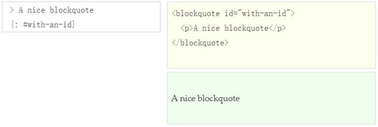

在 [LLJ](https://luolinjia.com) 的启发下，开始在Github创建个人网站。

使用 [Jekyll](https://jekyllcn.com/) 由 Github Page 生成静态网页。

而 Jekyll 使用开源模板语言 [Liquid](https://liquid.bootcss.com/) 。


使用由 [Alessio](https://alessiofranceschi.me/) 设计的主题
[Jekyll-Podcaster](https://github.com/PandaSekh/Jekyll-Podcaster)。

并将配色由浅蓝色改为浅绿色。

[Material Design User Interface](https://www.mdui.org/)
teal（主色）

~~~ruby
	mdui-color-teal      #009688
~~~


```java
    # ...ruby code
```


```ruby
	def foo
	  puts 'foo'
	end
```

使用 Markdown 记录内容，Markdown使用方法如下：

[jekyllrb](https://jekyllrb.com/docs/)

[jekyllrb.com/docs/](https://jekyllrb.com/docs/configuration/markdown/)


[kramdown](https://kramdown.gettalong.org/quickref.html)




增加了代码高亮显示功能。

```c
	#include <.h>
		#ifndef SYMBOL
		#define SYMBOL value
		#endif
	// this is code 

```

网站布局增加了 .pure-table，表格，仍在完善。

未来将参照 [Lightfish Zhang](https://lightfish.cn/) 的网站，美化布局。

将参照 [Feeling-Responsive](https://phlow.github.io/feeling-responsive/design/gallery/) 增加大图片浏览的效果。 

将融合 


以下是一些使用Jekyll搭建的网站

[long-pig](https://long-pig.cloudvent.net/)


[kejummao](https://github.com/KeJunMao/jekyll-theme-material)


[bit-ranger](https://github.com/bit-ranger/blog)


[字体设置](https://ridiqulous.com/chinese-webfont-guide/)

```css
font-family: Georgia, -apple-system, 'Nimbus Roman No9 L', 'PingFang SC', 'Hiragino Sans GB', 'Noto Serif SC', 'Microsoft Yahei', 'WenQuanYi Micro Hei', 'ST Heiti', sans-serif
```

```
font-family: Verdana, Arial, "Microsoft YaHei", "微软雅黑","Droid Sans", sans-serif;
```

使用了以下代码：

[LUOLINJIA](https://github.com/luolinjia/cn)


```
git add .

git commit -m "update new function"

git push origin master


```