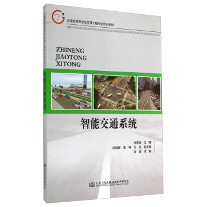

{: .bookcover}

<a href="https://space.bilibili.com/333058469/channel/detail?cid=103670">BiliBili DemosYe</a>

<!-- 

|:---------------------------:|:----------:|
| 题名                          | 借阅时间       |
| 蓝色巨人                        | 2009/9/28  |
| 大学物理简明教程                    | 2009/9/30  |
| 物理化学                        | 2009/9/30  |
| 弗兰克·劳埃德·赖特                  | 2009/10/10 |
| 当代中国建筑艺术精品集                 | 2009/10/10 |
| 中国楹联故事                      | 2009/10/12 |
| 我们的命运                       | 2009/10/16 |
| 英文经典歌词赏析                    | 2009/10/16 |
| 不可思议的e                      | 2009/10/19 |
| 中国报告文学年选                    | 2009/10/27 |
| 重庆通史                        | 2009/10/27 |
| 数学方法溯源                      | 2009/11/3  |
| 初等数学研究                      | 2009/11/3  |
| 浙大的大师们                      | 2009/11/10 |
| 人文地理随笔                      | 2009/11/10 |
| 无机化学                        | 2009/11/18 |
| 科学革命                        | 2009/12/9  |
| 医学·心理·民俗                    | 2009/12/9  |
| 生物技术与基因工程图解小百科              | 2009/12/15 |
| 濠镜风韵                        | 2009/12/15 |
| 象棋实用残局新招                    | 2010/1/5   |
| 中国民间禁忌风俗                    | 2010/1/5   |
| 20世纪英国文学史                   | 2010/1/13  |
| 后现代思想的数学根源                  | 2010/1/13  |
| 新概念素描与造型语言解析                | 2010/1/21  |
| 色彩构成                        | 2010/1/21  |
| 平面构成                        | 2010/1/21  |
| 中外建筑钢笔画                     | 2010/1/21  |
| 大学英语考试能力突破                  | 2010/3/2   |
| 概率论、随机过程与数理统计               | 2010/3/8   |
| 电动力学教学指导                    | 2010/3/8   |
| 图解电机电器                      | 2010/3/8   |
| 运筹学导论                       | 2010/3/12  |
| 中文版AutoCAD   2007建筑设计轻松现场实战 | 2010/3/12  |
| 预测未来                        | 2010/3/23  |
| 音乐启蒙书                       | 2010/3/23  |
| 二战秘密档案                      | 2010/3/24  |
| 狗娘养的战争                      | 2010/3/24  |
| Visual   C\+\+简明教程          | 2010/4/6   |
| 航天无线电测控原理与系统                | 2010/4/6   |
| C\+\+程序设计                   | 2010/4/16  |
| 快速学会看电子电路图                  | 2010/4/25  |
| 天线与电波传播                     | 2010/4/25  |
| 逻辑学基础                       | 2010/5/4   |
| 风格研究 文本理论                   | 2010/5/4   |
| 梵高与毕加索对话                    | 2010/5/5   |
| 建筑绘图与配景                     | 2010/5/5   |
| C语言程序设计习题解答与上机指导            | 2010/5/10  |
| 3ds max   2008中文版应用教程       | 2010/5/15  |
| 电子商务导论                      | 2010/5/24  |
| 广告创意案例评析                    | 2010/5/27  |
| 实用BIOS与注册表应用                | 2010/5/27  |
| 安利金牌销售员的秘密                  | 2010/5/31  |
| 工程制图                        | 2010/5/31  |
| 重拳出击                        | 2010/5/31  |
| 冬吴相对论                       | 2010/6/17  |
| 撬动地球的Google                 | 2010/6/17  |
| 微软360度                      | 2010/6/17  |
| 全国计算机等级考试笔试\+上机全真模拟         | 2010/6/17  |
| AutoCAD   2006中文版完全自学手册     | 2010/6/17  |
| 密码学基础                       | 2010/6/28  |
| IT导航图                       | 2010/6/28  |
| 麦肯锡传奇                       | 2010/7/5   |
| 奥美的观点IV                     | 2010/7/5   |
| 椭圆曲线密码算法导引                  | 2010/9/7   |
| 建筑夜景效果图制作                   | 2010/9/11  |
| 北京                          | 2010/9/11  |
| 慎修思永                        | 2010/9/11  |
| 心识的力量                       | 2010/9/13  |
| J2ME 技术手册                   | 2010/9/19  |
| J2ME应用教程                    | 2010/9/25  |
| 精通BIOS/注册表疑难解析与技巧1200例      | 2010/9/25  |
| 人月神话                        | 2010/10/8  |
| 3ds Max   2009基础教程          | 2010/10/8  |
| Java 程序设计                   | 2010/10/21 |
| 原子物理与量子力学                   | 2010/10/24 |
| 线性代数                        | 2010/10/31 |
| 问鼎苍穹                        | 2010/11/1  |
| 红楼梦悟                        | 2010/11/3  |
| 建筑诗学                        | 2010/11/3  |
| 大学英语核心语法                    | 2010/11/21 |
| 高等数学例题与习题集                  | 2010/11/26 |
| 世界现代设计史                     | 2010/11/30 |
| PowerBuilder编程技术全接触         | 2010/12/13 |
| 核能开发与应用                     | 2010/12/28 |
|                             |            |
 -->